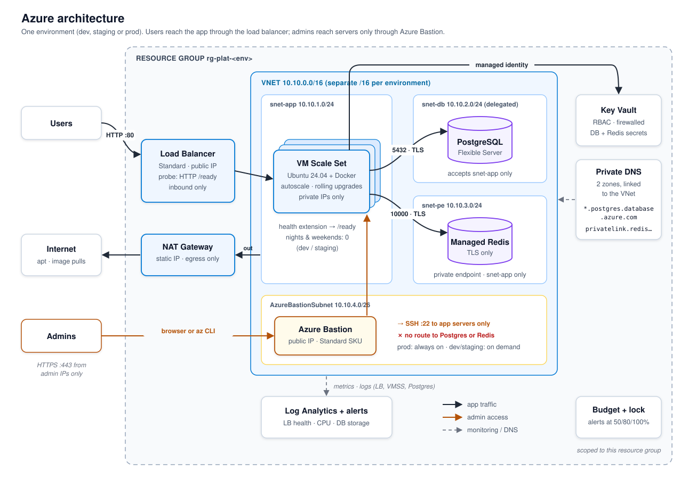
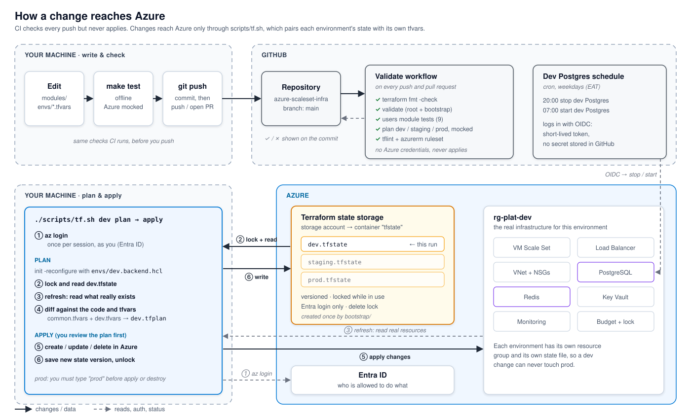

# azure-platform

Terraform for a small production-style platform on Azure: an autoscaling **VM Scale Set** behind a load balancer, **PostgreSQL** and **Redis** on private networking, secrets in **Key Vault**, Linux **users managed as code**, and **budgets, locks and auto-shutdown** to keep costs under control.

One codebase, three environments (`dev`, `staging`, `prod`). Everything that differs between them lives in a tfvars file.

## Architecture



## How a change reaches Azure



CI validates every push without touching Azure. Changes are applied from your machine with `scripts/tf.sh`, which always pairs an environment's state file with its own tfvars.

## Environments

| | dev | staging | prod |
|---|---|---|---|
| VM size / instances | B2s, 1–2 | B2s, 1–3 | D2as_v5, 2–6 across 3 zones |
| Off-hours scale to zero | Yes | Yes | Never |
| Postgres | Burstable B1ms, 7-day backups | Burstable B1ms | General Purpose, zone-redundant HA, 35-day geo-redundant backups |
| Redis | Off (bills 24/7) | Balanced_B0 | Balanced_B1, HA |
| SSH | Admin IPs | Admin IPs | Closed |
| Budget | 30 | 60 | 400 |
| Delete lock | No | No | Yes |
| Key Vault purge protection | No | No | Yes |

`tests/environments.tftest.hcl` enforces the prod rules: if someone turns off HA or adds a night schedule in `prod.tfvars`, the tests fail.

## Layout

```
bootstrap/          one-time: storage account for Terraform state (local state)
envs/
  common.tfvars     shared settings + the user list
  <env>.tfvars      what makes each environment different
  <env>.backend.hcl which state file each environment uses
modules/
  network/          VNet, 3 subnets, NSGs, private DNS zones
  users/            validates users, renders cloud-init (no Azure resources)
  compute-vmss/     scale set, cloud-init, health extension, rolling upgrades, autoscale
  loadbalancer/     public IP, LB, /ready probe, outbound rule, SSH NAT
  postgres/         Flexible Server, private access, write-only password
  redis/            Azure Managed Redis + private endpoint
  keyvault/         vault (RBAC + firewall) and secrets
  governance/       budget alerts, delete lock
  monitoring/       Log Analytics, action group, metric alerts
scripts/
  tf.sh             runs Terraform for exactly one environment
  whoami-on-instances.sh   lists Linux users on every instance
tests/              plans all environments against mocked providers
```

## Getting started

**You need:** Terraform ≥ 1.11, Azure CLI (`az login`), `jq`. Your account must be able to create role assignments: Owner, or Contributor plus User Access Administrator.

```bash
# 1. One-time: create the state storage
cd bootstrap && terraform init && terraform apply
terraform output backend_config        # copy storage_account_name into envs/*.backend.hcl
cd ..

# 2. Your real values, git-ignored
cat > envs/common.local.tfvars <<'TF'
alert_emails = ["you@example.com"]
admin_cidrs  = ["<your-public-ip>/32"]   # curl -s ifconfig.me
app_image    = "ghcr.io/<you>/node-cicd-pipeline:<tag>"
TF

# 3. Put real public keys in envs/common.tfvars (the ones there are examples)

# 4. Build an environment
./scripts/tf.sh dev plan
./scripts/tf.sh dev apply
./scripts/tf.sh dev output app_url
```

Commit `.terraform.lock.hcl` after the first `init` so everyone gets the same provider versions.

`tf.sh` re-initialises against the chosen environment's state on every run and always loads the matching tfvars. You can't plan prod with dev's state, and prod asks you to type `prod` before applying or destroying.

## Managing Linux users

Users are declared once in `envs/common.tfvars`:

```hcl
users = {
  duncan = { ssh_keys = ["ssh-ed25519 AAAA..."], sudo = true,  environments = ["dev", "staging", "prod"] }
  dev1   = { ssh_keys = ["ssh-ed25519 AAAA..."], sudo = false, environments = ["dev", "staging"] }
}
```

- **Rules enforced before anything is created:** valid Linux usernames, ed25519 keys only, no reserved names (`root`, the break-glass admin, ...), known environments only.
- **Per environment:** a user exists in an environment only if it's in their list. `dev1` never exists in prod.
- **Sudo users** also join the `docker` group. Others can log in but can't control containers.
- **No passwords exist.** Accounts are locked; SSH keys only. Root login is off.

**Offboarding is a one-line delete.** Remove the user and apply. The scale set model changes, and a **max-surge rolling upgrade** builds fresh instances from the new model, then removes the old ones. Every instance boots from scratch, so the account doesn't exist anywhere afterwards and no stale keys are left behind. Prove it with:

```bash
./scripts/whoami-on-instances.sh dev
```

This uses Azure Run Command, so it works even with SSH closed.

**Break-glass:** the scale set's own admin account (`platformadmin`) has a key that exists only in Key Vault. Fetch it with `terraform output breakglass_key_command`, in emergencies only.

## Deploying a new app version

Set `app_image` to the new tag and apply. The image is part of the cloud-init, so the change triggers the same rolling upgrade:

- New instances are created first (surge), so capacity never drops.
- An instance only counts as healthy once its `/ready` endpoint responds through the Application Health extension.
- `max_unhealthy_upgraded_instance_percent = 0` **halts the rollout** if any new instance is unhealthy. The old instances keep serving.

Project 1's pipeline can deploy by running `./scripts/tf.sh <env> apply -var app_image=...`.

## Secrets

- **Postgres password:** generated as an **ephemeral** value and sent to Postgres and Key Vault as **write-only** attributes. It never appears in state, plans or logs.
  - To rotate it, bump `postgres_password_version` and apply. Postgres and Key Vault update together, and instances read the new value on their next boot.
- **Instances read secrets with their managed identity**, through the Key Vault firewall via a service endpoint. No credentials are stored on disk or in the scale set definition.
- **Key Vault is closed by default:** only `admin_cidrs` and the app subnet get through. Terraform must run from an IP in `admin_cidrs`.

## Cost controls

- **Budgets:** each environment's resource group emails `alert_emails` at 50%, 80% and 100% of actual spend, and at 100% of **forecast** spend.
- **Scale to zero:** dev and staging drop to 0 instances at 20:00 on weekdays and come back at 07:00 (EAT). The Friday-evening stop lasts until Monday morning.
- **Dev Postgres** is stopped and started on the same schedule by `.github/workflows/dev-shutdown.yml`. Terraform can't stop a server; that's runtime state, not configuration.
- **Redis is off in dev**, because Managed Redis can't be stopped and bills around the clock.
- **Log Analytics** has a 1 GB/day cap.

Prices vary by region and change over time, so check the [Azure pricing calculator](https://azure.microsoft.com/pricing/calculator/) before applying staging or prod. Apply prod only briefly if you're exploring.

### One-time setup for the dev Postgres schedule (OIDC, no secrets)

```bash
APP_ID=$(az ad app create --display-name gh-dev-scheduler --query appId -o tsv)
az ad sp create --id "$APP_ID"
az ad app federated-credential create --id "$APP_ID" --parameters '{
  "name": "github-main",
  "issuer": "https://token.actions.githubusercontent.com",
  "subject": "repo:<owner>/<repo>:ref:refs/heads/main",
  "audiences": ["api://AzureADTokenExchange"]
}'
az role assignment create --assignee "$APP_ID" --role Contributor \
  --scope "/subscriptions/<subscription-id>/resourceGroups/rg-plat-dev"
```

Then add these GitHub **repository variables**:
- `AZURE_CLIENT_ID`, `AZURE_TENANT_ID`, `AZURE_SUBSCRIPTION_ID`
- `DEV_RESOURCE_GROUP` = `rg-plat-dev`
- `DEV_POSTGRES_SERVER`, from `./scripts/tf.sh dev output -raw postgres_server_name`

## Destroying an environment

```bash
./scripts/tf.sh dev destroy
```

Prod has a CanNotDelete lock, so destroying it is deliberately a two-step action:
1. Set `lock_enabled = false` in `prod.tfvars` and apply.
2. Destroy.

## Testing

Everything below runs without an Azure account (`make test`):

| Check | What it proves |
|---|---|
| `terraform validate` | Every module is valid against the real azurerm v5 schema |
| `modules/users` tests (9) | Filtering per environment, sudo handling, rejection of RSA keys, bad names and reserved names |
| `tests/environments.tftest.hcl` × 3 | Each environment's full plan works with mocked providers, and prod keeps HA, its lock and purge protection |
| `tflint` + azurerm ruleset | Provider-specific mistakes `validate` can't see |

CI runs all of it on every push.

## Design decisions

- **Separate state per environment**, chosen by `-backend-config`, rather than workspaces. A wrong `terraform workspace select` can't apply dev changes to prod.
- **Users in cloud-init, not configured after boot.** Scale set instances come and go; anything configured after boot drifts. Baking users in means every instance is identical, and removal is guaranteed.
- **Max-surge rolling upgrades:** new instances first, old ones removed after, gated by the health extension. Deploys and user changes never reduce capacity.
- **Explicit outbound** through a load balancer rule, with `default_outbound_access_enabled = false`, because Azure has retired implicit outbound access for new subnets.
- **Azure Managed Redis**, not Azure Cache for Redis, which is closed to new customers and being retired.
- **`EnterpriseCluster` clustering policy**, so ordinary Redis clients work without cluster support.
- **`prevent_destroy` can't vary per environment** in Terraform, so it's only on the state storage. Prod relies on the resource lock, soft delete and purge protection instead. tflint exemptions explain this inline.

## Known limitations and next steps

- **HTTP only.** Add TLS with Azure Front Door, Application Gateway or Cloudflare in front of the load balancer.
- **Users and app image share cloud-init**, so changing either replaces every instance. That's fine at this size; a larger setup would bake a golden image with Packer.
- **Terraform state still contains** the break-glass private key and the Redis access key, because those resources expose them. The state storage is therefore Entra-only, versioned and locked. Treat state access as admin access.
- **Region:** check Azure Managed Redis is available in your region before enabling it. If not, change `location`.
- **The app from project 1** reads Postgres via `PG*` variables already. `REDIS_URL` is provided, but the app doesn't use Redis yet.
- **The container image must be public**, or you need to add registry credentials.
